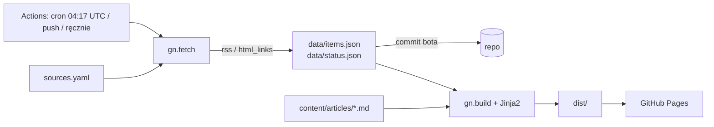

# 01 – Architektura (demo na GitHubie)

## Przepływ dzienny
1. `gn.fetch` czyta `sources.yaml` i dla każdego źródła wywołuje adapter.
2. Z jednego źródła bierze maks. 30 najnowszych wpisów; deduplikacja po `id` (SHA-1 z URL) oraz po parze (źródło, tytuł).
3. Istniejące wpisy nie są nadpisywane. Plik trzyma maks. 600 wpisów.
4. Bot commituje `data/`; push tokenem `GITHUB_TOKEN` nie uruchamia kolejnego workflow.
5. `gn.build` generuje `dist/` i wdraża na Pages.

## Model wpisu (`data/items.json`)
| Pole | Opis |
|---|---|
| `id` | 16 znaków SHA-1 z URL |
| `source`, `source_name` | identyfikator i nazwa źródła |
| `category` | slug kategorii z `site.yaml` |
| `title`, `lead` | tytuł i zajawka (≤220 znaków) |
| `url` | link do oryginału |
| `published` | data ISO; gdy strona jej nie podaje – data pobrania |
| `fetched_at` | czas pobrania (UTC) |

## Adaptery
- **`rss`** – RSS/Atom przez `feedparser`.
- **`html_links`** – bez selektorów CSS: zbiera linki pasujące do `link_pattern`, a tytuł, datę
  (`DD.MM.RRRR` lub `RRRR-MM-DD`) i lead bierze z najbliższego kontenera zawierającego tylko ten wpis.
  Odporny na zmiany klas; zawodzi, gdy lista nie ma linków z unikalnym wzorcem URL.

## Strony w `dist/`
`/` · `/kategoria/{slug}/` · `/artykul/{slug}/` · `/rozrywka/` · `/zrodla/` · `search.json`

## Ograniczenia wersji demo
- Adaptery są przetestowane na próbkach offline; pierwszy przebieg na żywych stronach następuje w Actions.
- Cron w Actions bywa opóźniony; harmonogram wyłącza się po 60 dniach bez aktywności w repo.
- Pogoda (Open-Meteo) i wyszukiwarka działają w przeglądarce; brak newslettera i formularzy.
