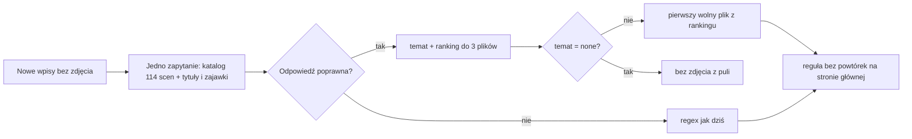

# Dobór ilustracji modelem AI — decyzje, prompt i test (2026-11-23)

Stan: **etap 1 gotowy do testu** (wywołanie modelu, walidacja, raport porównawczy). Serwisy działają bez zmian:
nic nie jest jeszcze podłączone do pobierania ani budowy.

## Decyzje (Marek, 23.11.2026)

| Temat | Decyzja |
|---|---|
| Wariant | C w jednym wywołaniu: model zwraca temat i ranking najwyżej 3 plików z tego tematu |
| Dostawca | OpenRouter (istniejące konto Marka) |
| Model | `anthropic/claude-haiku-5.5`; zmiana modelu = jeden parametr |
| Dane dla modelu | tylko identyfikator, tytuł i zajawka wpisu |

Ceny z 23.11.2026: 0,10 USD za 1 mln tokenów wejścia, 0,50 USD za 1 mln wyjścia. Szacunek dla trzech
serwisów: poniżej 1 zł miesięcznie.

## Jak to działa



## Pliki

| Plik | Rola |
|---|---|
| `gn/photo_scenes.yaml` | katalog scen: opis każdej z 19 grup i każdego ze 114 plików (sprawdzony z obrazami 23.11) |
| `gn/photo_ai.py` | prompt, wywołanie OpenRouter, walidacja odpowiedzi, raport „regex kontra model” |
| `tests/test_photo_ai.py` | testy bez sieci, w tym zgodność katalogu z plikami puli |

Po podmianie obrazu w puli trzeba poprawić jego opis w `gn/photo_scenes.yaml`. Plik bez opisu nie jest
proponowany modelowi, a test zgłasza brak.

## Prompt i odpowiedź

Prompt systemowy (stała `PROMPT` w `gn/photo_ai.py`, podgląd: `python -m gn.photo_ai --prompt`) ma ok. 2,6 tys.
tokenów i zawiera: rolę, katalog scen, zasady wyboru tematu i plików oraz zasadę `none`. Wpisy idą w wiadomości
użytkownika, po jednym obiekcie JSON w wierszu, paczkami po 25.

Odpowiedź modelu:

```json
{"items": [{"id": "d20090b8bfcca7d3", "topic": "police", "picks": ["police-4", "police-5"]}]}
```

Zasady w prompcie:
- Temat według znaczenia, nie pojedynczych słów („dziki lokator” to nie dziki, „sesja zdjęciowa” to nie rada).
- `general`, gdy temat jest neutralny, ale nie pasuje do żadnej grupy.
- `picks` tylko z wybranej grupy, od najlepszego; mniej niż 3, gdy pozostałe sceny nie pasują wymową.
- `none` z pustą listą przy tematach wrażliwych: śmierć, pogrzeb, wypadek z ofiarami, przemoc, przestępstwo
  wobec osoby, zaginięcie, krzywda dzieci, samobójstwo, ciężka choroba konkretnej osoby.

## Walidacja (`parse_answer`)

- Odrzucane: identyfikatory spoza paczki, tematy spoza katalogu, pliki spoza wybranego tematu, duplikaty.
- Temat poprawny bez żadnego poprawnego pliku zostaje; kolejność plików będzie wtedy domyślna.
- Odpowiedź nieczytelna albo błąd sieci: wpis zostaje przy regexie. Błąd jednej paczki nie przerywa kolejnych.
- Limit wywołań na przebieg (`max_calls`). Limit kwotowy ustawia się na kluczu w OpenRouterze.

## Test przed włączeniem

Raport pokazuje obok siebie wybór regexu i wybór modelu dla najnowszych wpisów bez zdjęcia. Przy każdym wierszu
zaznacza się, co jest lepsze; licznik u góry sumuje oceny.

```powershell
cd $HOME\Downloads\grodzisk-news
git pull
Expand-Archive ..\dobor-zdjec-ai-test-v2.zip -DestinationPath . -Force
pip install -r requirements.txt
$env:OPENROUTER_API_KEY = Read-Host "Klucz OpenRouter"
python -m gn.photo_ai --compare 50
start photo_ai_report.html
```

- Klucz: osobny klucz w OpenRouterze z limitem kwotowym; wpisywany tylko w oknie PowerShell, nigdy w repo ani w rozmowie.
- Raport (`photo_ai_report.html`) jest w `.gitignore`; plików testu nie trzeba commitować.
- Grodzisk ma dziś 44 wpisy bez zdjęcia, więc do 50 ocen warto uruchomić test także w `saskakepa-news`;
  w `boppard-news` sprawdza się język niemiecki.
- Inny model do porównania: `python -m gn.photo_ai --compare 50 --model <identyfikator z OpenRouter>`.

Propozycja kryterium (do potwierdzenia): włączamy, gdy model wygrywa z regexem co najmniej 3:1 wśród wierszy
z różnicą i nie ma ani jednego zdjęcia przy temacie wrażliwym.

## Etap 2 — podłączenie (po udanym teście, jeszcze niezbudowane)

1. `gn.fetch`: po `add_images` wpisy bez zdjęcia i bez pola `photo_ai` idą do modelu; wynik zapisany przy wpisie
   w `data/items.json` jako `photo_ai: {topic, picks}`. Każdy wpis pytany raz; przy błędzie pole nie powstaje
   i wpis próbuje ponownie w następnym przebiegu.
2. `gn.build`: `photo_candidates` bierze najpierw `picks`, potem resztę grupy, potem `general`; brak pola → regex.
   Reguła „bez powtórek na stronie głównej” bez zmian.
3. `build.yml`: sekret `OPENROUTER_API_KEY` w kroku „Pobierz źródła”; bez sekretu krok działa jak dziś.
4. Po przejściu pobierania na VPS klucz trafia do pliku środowiskowego na serwerze.

## Otwarte decyzje

- `none`: karta bez zdjęcia z puli (ikona kategorii) czy neutralne zdjęcie z `general`. Założenie robocze: bez zdjęcia.
- Wpisy już zapisane: klasyfikować jednorazowo (kilkaset na serwis, koszt groszowy) czy tylko nowe.
- Kryterium włączenia z sekcji „Test przed włączeniem”.
