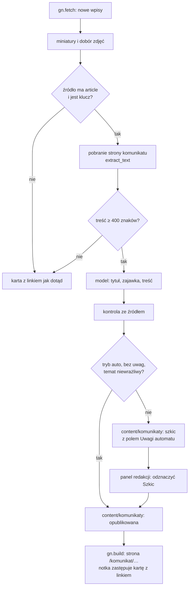

# Artykuły na podstawie oficjalnych komunikatów (stan: 2026-11-24)

Stan: **zbudowane i przetestowane bez sieci; na żywo niesprawdzone.** Model i strony źródeł były w testach
podstawiane, więc jakość tekstów i trafność wyciągania treści ze stron pokaże dopiero pierwszy przebieg w Grodzisku.

## Decyzje (Marek, 24.11.2026)

| Temat | Decyzja |
|---|---|
| Zakres | najpierw Grodzisk; Saska Kępa i Boppard po ocenie jakości |
| Tryb | hybryda: część źródeł publikuje od razu, część zapisuje szkic do zatwierdzenia w panelu |
| Policja | zostaje; komunikaty wolno przetwarzać z podaniem źródła (ustalenie Marka z policją i urzędnikami) |
| Długość | notka: tytuł, zajawka, 2–4 akapity (500–900 znaków) |
| Karta na stronie | prowadzi do naszej notki; link do komunikatu jest pod tekstem |
| Źródło | zawsze stopka „Opracowanie redakcji z pomocą AI na podstawie komunikatu. Źródło: …” z linkiem |

Tryb źródeł w Grodzisku (propozycja Claude, do zmiany w `sources.yaml`):

| Tryb | Źródła |
|---|---|
| `auto` | biblioteka, ck, gpa, odpady, osir |
| `draft` | gmina, powiat, solectwa, szpital, policja |
| bez notek | ck-wydarzenia, osir-wydarzenia (kalendarze), psp i wkd (wyłączone) |

## Jak to działa



## Kontrola notki

Każda uwaga zamienia publikację w szkic. Uwagi trafiają do pola `check_notes` („Uwagi automatu” w panelu).

| Kontrola | Reguła |
|---|---|
| Liczby | każda liczba z notki (data, godzina, kwota, numer) musi być w komunikacie; przy błędzie model dostaje jedną poprawkę |
| Nazwy własne | słowo wielką literą w środku zdania musi występować w komunikacie (także w innej odmianie); tylko po polsku |
| Cytaty | tekst w cudzysłowie od 20 znaków musi być w komunikacie dosłownie |
| Długość | treść 300–1600 znaków, tytuł do 110, zajawka do 260 |
| Temat wrażliwy | wpis oznaczony przez dobór zdjęć jako `none` zawsze idzie do szkicu |
| Czystość | z odpowiedzi modelu usuwane są HTML, linki i składnia Markdown |

Ograniczenia kontroli: nie wykrywa liczb zapisanych słownie, zmienionego sensu zdania ani błędnego
przypisania faktu (np. właściwa godzina przy niewłaściwym wydarzeniu). Kontrola nazw jest przybliżona
(porównuje początki słów). Dlatego źródła urzędowe i policja startują w trybie `draft`.

## Stan wpisu (`data/items.json`, pole `article`)

| `state` | Znaczenie | Ponowna próba |
|---|---|---|
| `published` | notka opublikowana, plik w `file` | nie |
| `draft` | szkic czeka w panelu; powód w `note` | nie |
| `skipped` | komunikat za krótki albo model uznał, że nie ma z czego pisać | nie |
| `rejected` | odpowiedź modelu nie do odczytania | nie |
| brak pola | wpis jeszcze nieruszany albo błąd sieci | tak, w następnym przebiegu |

Przerabiane są wpisy z ostatnich 5 dni, najwyżej 10 na przebieg (30 dziennie). Ponowne napisanie notki:
usunąć pole `article` z wpisu i plik notki.

## Pliki

| Plik | Rola |
|---|---|
| `gn/article_ai.py` | treść ze strony, prompt, wywołanie OpenRouter, kontrola, zapis, `annotate`, polecenia ręczne |
| `gn/fetch.py` | po doborze zdjęć woła `article_ai.annotate`; wyjątek nie przerywa przebiegu |
| `gn/build.py` | `load_releases`, `attach_releases`: notka zastępuje wpis, przejmuje miniaturę i ilustrację |
| `gn/models.py` | `slugify` przeniesione z `gn/build.py` |
| `templates/article.html` | zdjęcie ze źródła lub z puli, stopka ze źródłem |
| `templates/zrodla.html` | linia „Artykuły z komunikatów”: opublikowane, szkice, wyniki |
| `templates/_macros.html`, `templates/index.html` | rozpoznawanie miniatury zewnętrznej po adresie (`image_remote`) |
| `i18n/pl.yaml`, `i18n/de.yaml` | teksty stopki i statystyk; ścieżka `release` (`komunikat` / `meldung`) |
| `static/style.css` | `.source-note` |
| `.github/workflows/build.yml` | bot zapisuje też `content/komunikaty/` |
| `tests/test_article_ai.py` | 17 testów bez sieci |

## Włączenie (Grodzisk)

1. Wgrać paczkę z kodem. Bez kroków 2–3 nic się nie zmienia.
2. `sources.yaml` na GitHubie: dopisać linię `article:` przy źródłach.

   ```yaml
   # przy: biblioteka, ck, gpa, odpady, osir
       article: auto
   # przy: gmina, powiat, solectwa, szpital, policja
       article: draft
   ```

3. `admin/config.yml` na GitHubie: dopisać drugą kolekcję na końcu pliku (wcięcie jak przy `articles`).

   ```yaml
     - name: releases
       label: Artykuły z komunikatów
       label_singular: Artykuł z komunikatu
       folder: content/komunikaty
       create: false
       extension: md
       format: yaml-frontmatter
       summary: "{{title}} ({{date}}) {{check_notes}}"
       sortable_fields: [date, title]
       fields:
         - {label: Szkic (nie publikuj), name: draft, widget: boolean, default: true, hint: "Odznacz, żeby opublikować."}
         - {label: Uwagi automatu, name: check_notes, widget: string, required: false, hint: "Co kontrola uznała za niepewne. Sprawdź z komunikatem."}
         - {label: Tytuł, name: title, widget: string}
         - {label: Zajawka, name: lead, widget: text, required: false}
         - {label: Treść, name: body, widget: markdown}
         - {label: Źródło, name: source_name, widget: string}
         - {label: Adres komunikatu, name: source_url, widget: string}
         - {label: Data publikacji, name: date, widget: datetime, type: date}
         - label: Kategoria
           name: category
           widget: select
           options:
             - {label: Miasto i gmina, value: miasto}
             - {label: Powiat, value: powiat}
             - {label: Kultura, value: kultura}
             - {label: Sport, value: sport}
             - {label: Zdrowie, value: zdrowie}
             - {label: Bezpieczeństwo, value: bezpieczenstwo}
             - {label: Transport, value: transport}
         - {name: item_id, widget: hidden}
   ```

4. Sekret `OPENROUTER_API_KEY` jest ten sam co przy doborze zdjęć.
5. W logu kroku „Pobierz źródła” pojawi się linia „Artykuły AI (…): wpisów …, opublikowane …, szkice …”.
6. Wyłączenie: usunąć linie `article:` z `sources.yaml`. Opublikowane notki zostają.

Opcjonalne klucze w `site.yaml`: `article_ai_model` (domyślnie model od zdjęć, `anthropic/claude-haiku-5.5`),
`article_ai_per_run` (domyślnie 10). Opcjonalny klucz źródła: `article_selector` (selektor CSS treści komunikatu).

## Sprawdzenie ręczne (Windows, w folderze repo)

```powershell
py -m gn.article_ai --extract https://gpagrodzisk.pl/aktualnosci/101/   # co model dostanie ze strony (bez klucza)
$env:OPENROUTER_API_KEY = "sk-or-..."
py -m gn.article_ai --try https://gpagrodzisk.pl/aktualnosci/101/       # notka i wynik kontroli, bez zapisu
py -m gn.article_ai --prompt                                            # prompt systemowy
```

Gdy `--extract` pokazuje menu albo stopkę zamiast treści, źródło potrzebuje `article_selector`.

## Koszt

Szacunek, nie pomiar: ok. 2,5 tys. tokenów wejścia i 700 wyjścia na notkę, czyli ok. 0,2 grosza przy cenach
Haiku z 23.11.2026. Przy 30 notkach dziennie to 2–3 zł miesięcznie. Poprawka liczb podwaja koszt jednej notki.

## Otwarte

- Pierwszy przebieg na żywo: jakość tekstów, odsetek szkiców z uwagami, trafność `extract_text` na 10 źródłach.
- Fałszywe alarmy kontroli nazw (odmiana, skróty) mogą niepotrzebnie spychać notki do szkiców.
- Miniatury biblioteki to plakaty; na stronie notki wyświetlają się w całości.
- Powiadomienie o czekających szkicach: dziś tylko licznik na `/zrodla/` i lista w panelu.
- Przed wersją komercyjną: obowiązki oznaczania treści AI i prawo prasowe do sprawdzenia przez prawnika.
